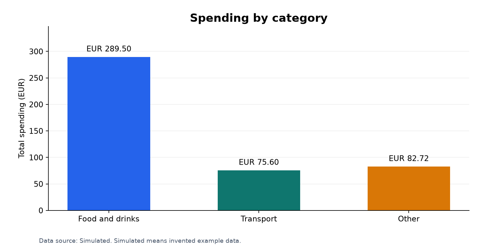
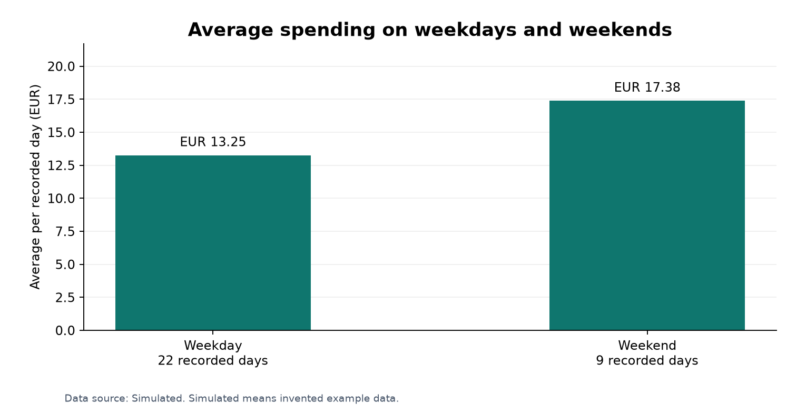
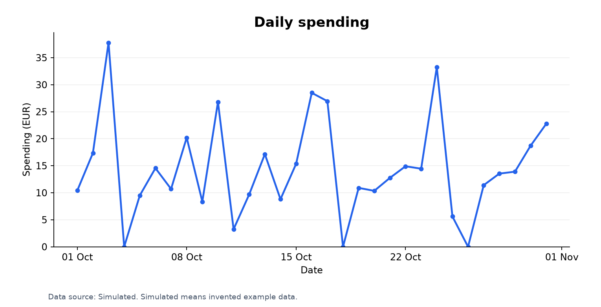
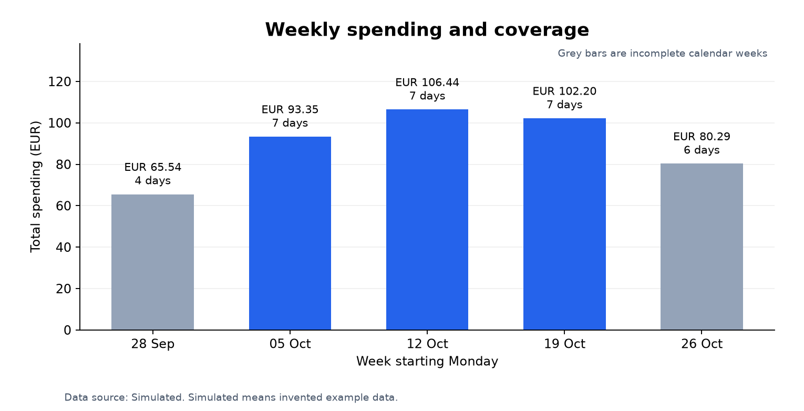

# Data Centric Programming Assignment 2026

**Project:** Personal Spending Tracker

**Name:** Ali Assylkhan

**Student number:** A00047481

**Course:** TU850

**GitHub:** [slimnomad](https://github.com/slimnomad)

[Assignment brief](https://github.com/skooter500/dcp26-assignment/blob/main/dataset_assignment.md) · [Dataset](spending_tracker.csv) · [Data dictionary](data_dictionary.md) · [Analysis report](reports/summary.txt)

This project uses Python to store, analyse, and visualise daily spending. A console menu lets the user view records, search dates, compare categories, generate charts, and add another day.

The included dataset contains **31 simulated daily records for 1–31 October 2026**. The amounts are invented examples of student spending. Every included row is labelled `Simulated`; the application also supports a `Recorded` label for actual observations.

# Questions

The project investigates three questions:

**1. Which category accounts for the largest share of spending?**

**2. How does average daily spending differ between weekdays and weekends?**

**3. How does spending change from day to day and from week to week?**

The analysis also identifies the highest-spending day, the number of zero-spending days, and the highest-spending complete week.

# Data Dictionary

One row represents one calendar day. Spending is split into food and drinks, transport, and other purchases. Amounts are in euro.

| Column | Data type | Unit / values | Description | Example |
| --- | --- | --- | --- | --- |
| `date` | Date | DD-MM-YYYY | Date of the daily record. | 01-10-2026 |
| `food_drink_eur` | Decimal | EUR, zero or more | Food, groceries, meals, snacks, and drinks. | 6.80 |
| `transport_eur` | Decimal | EUR, zero or more | Transport spending during the day. | 3.60 |
| `other_eur` | Decimal | EUR, zero or more | Purchases outside the other two categories. | 0.00 |
| `total_eur` | Decimal | EUR, zero or more | Sum of the three spending categories. | 10.40 |
| `day_type` | Categorical | Weekday / Weekend | Monday–Friday or Saturday–Sunday. | Weekday |
| `data_source` | Categorical | Simulated / Recorded | Whether the row is an invented example or an actual observation. | Simulated |

### Data rules

- Each date appears once, using DD-MM-YYYY and a year from 1900 to 2100.
- Each expense belongs to one category.
- Amounts must be non-negative and have at most two decimal places.
- The total must equal food and drinks + transport + other spending.
- The day type must agree with the calendar date.
- A zero-spending day is included as a row with zero amounts. A missing date is not treated as zero.
- The source label is stored with every record in both CSV and SQLite.

The [separate data dictionary](data_dictionary.md) explains the database fields and calculation rules in more detail.

# Description of the project

The Personal Spending Tracker connects a CSV dataset to a working database and analysis application.

| Technology | Role in the project |
| --- | --- |
| Python | Console interface, input validation, and application logic. |
| CSV | Readable source dataset and exported analysis tables. |
| SQLite | Validated local database and SQL queries. |
| pandas | DataFrames, category summaries, date grouping, and weekly analysis. |
| matplotlib | Four charts saved as PNG files. |
| Git and GitHub | Version history, project files, and documentation. |

The application is split into three Python files: `main.py` for the menu, `tracker.py` for data and analysis, and `charts.py` for visualisation.

# Instructions for use

### 1. Download the project

Clone this repository, or use **Code → Download ZIP** on GitHub and extract it.

```bash
git clone https://github.com/slimnomad/dcp-spending-tracker.git
cd dcp-spending-tracker
```

### 2. Set up Python

Open the project folder in Visual Studio Code. In the integrated terminal, create a virtual environment and install the requirements:

```bash
python3 -m venv .venv
source .venv/bin/activate
python -m pip install -r requirements.txt
```

On Windows, use `.venv\Scripts\activate` to activate the environment. Select the interpreter inside `.venv` in VS Code.

The project was tested with **Python 3.13, pandas 2.3.3, and matplotlib 3.11.2**. SQLite is included with Python.

### 3. Run the application

```bash
python main.py
```

The program validates the CSV and loads its rows into `data/spending.db`. The included database, charts, and reports are already populated, and the application can recreate them.

```text
===== PERSONAL SPENDING TRACKER =====
Data sources: {'Simulated': 31}
1. View all records
2. Find a day or date range
3. Total spending and category comparison
4. Compare weekdays and weekends
5. Weekly summary
6. Generate charts
7. Add a daily record
8. Export analysis reports
0. Exit
Choose an option:
```

### Using the menu

- **Option 2:** enter a start date and an end date. Both dates are included. Leave the end date blank to find one day.
- **Options 3–5:** view overall totals, category shares, weekday/weekend averages, and weekly spending.
- **Option 6:** save four charts in `images/`. Open the PNG files in VS Code or an image viewer.
- **Option 7:** enter a date, three spending amounts, and a source label. The program calculates the total and day type, then updates the CSV and database. Duplicate dates are rejected.
- **Option 8:** export a text summary and three CSV analysis tables to `reports/`.

If the CSV is edited manually, restart the program to reload it. Invalid input produces a message explaining what to correct. A rejected CSV import leaves the previous database contents intact.

# How it works

1. **Read the CSV.** Check the seven column headings and read each daily record.
2. **Validate the records.** Check dates, duplicate dates, missing fields, amounts, totals, day types, and source labels.
3. **Load SQLite.** Replace the derived database rows in one transaction. Repeated imports do not create duplicates.
4. **Run SQL queries.** Use `WHERE`, `GROUP BY`, `ORDER BY`, `COUNT`, `SUM`, and `AVG` to filter and summarise records.
5. **Analyse with pandas.** Load the table into a DataFrame, calculate category shares, find the highest-spending day, and group records into weeks.
6. **Create charts and reports.** Save the analysis in files that can be viewed without running the program again.

Money is stored as **integer cents** in SQLite: EUR 7.50 becomes 750. This keeps spending totals exact. Dates are stored as YYYY-MM-DD so SQL can sort and filter them correctly.

The [SQL queries file](sql_queries.sql) contains readable examples for the actual database table. Weeks start on Monday, and each weekly result includes its number of days. A complete calendar week has seven records.

# Findings

These results describe the **included simulated dataset**. The month contains 31 records: **22 weekdays, nine weekend days, and three zero-spending days**.

| Measure | Result |
| --- | --- |
| Total spending | EUR 447.82 |
| Average spending per day | EUR 14.45 |
| Highest-spending day | 3 October — EUR 37.79 |
| Highest-spending complete week | Week starting 12 October — EUR 106.44 |

### 1. Which category accounts for the largest share?

Food and drinks account for **EUR 289.50**, or **64.65%** of all spending. Transport accounts for **EUR 75.60 (16.88%)**, and other purchases account for **EUR 82.72 (18.47%)**. Food and drinks are therefore the largest category in this dataset.



### 2. How do weekdays and weekends compare?

Average weekend spending is **EUR 17.38 per day**, compared with **EUR 13.25 on weekdays**: a difference of approximately **EUR 4.13**. The chart compares daily averages because the dataset has different numbers of weekdays and weekend days.



### 3. How does spending change over time?

Daily spending varies from **EUR 0.00 to EUR 37.79**. The highest daily total occurs on 3 October. Three dates have no spending: 4, 18, and 26 October.



Among the three complete calendar weeks, the week starting **12 October** has the highest total, **EUR 106.44**. The first and last weeks contain only four and six October dates respectively, so their totals are labelled as partial weeks. The grey bars show those incomplete weeks.



### Limitations and reflection

The dataset is simulated and covers one month, so these patterns are examples of what the analysis can show rather than conclusions about real personal spending. The categories are broad, particularly `Other`, and daily totals do not identify individual purchases.

Including zero-spending days makes the daily averages more meaningful. Showing the number of days in each group also avoids comparing a partial week with a full week as if they had equal coverage.

After adding or editing records, use options **6** and **8** to refresh the charts and reports. The written findings above refer to the original 31-row dataset.

# List of files in the project

| File or folder | Purpose |
| --- | --- |
| [main.py](main.py) | Interactive console menu and user input. |
| [tracker.py](tracker.py) | Validation, CSV storage, SQLite queries, and analysis. |
| [charts.py](charts.py) | Four matplotlib charts. |
| [spending_tracker.csv](spending_tracker.csv) | The 31-row simulated dataset. |
| [data/spending.db](data/spending.db) | SQLite database loaded from the CSV. |
| [data_dictionary.md](data_dictionary.md) | Variables, units, storage, and validation rules. |
| [sql_queries.sql](sql_queries.sql) | SQL examples for filtering, grouping, and summaries. |
| [requirements.txt](requirements.txt) | Required third-party Python packages and versions. |
| [images/](images/) | Four generated PNG charts. |
| [reports/summary.txt](reports/summary.txt) | Complete text analysis. |
| [reports/category_totals.csv](reports/category_totals.csv) | Category totals and percentage shares. |
| [reports/weekday_weekend.csv](reports/weekday_weekend.csv) | Day-type counts, totals, and averages. |
| [reports/weekly_summary.csv](reports/weekly_summary.csv) | Weekly totals, averages, and coverage. |
| [.vscode/](.vscode/) | VS Code interpreter and run configuration. |
| [.gitignore](.gitignore) | Excludes environments, caches, and temporary files. |

# References

- [Lecturer's assignment brief](https://github.com/skooter500/dcp26-assignment/blob/main/dataset_assignment.md)
- [Lecturer's README template](https://github.com/skooter500/dcp26-assignment/blob/main/README.MD)
- [Askada21 study tracker example](https://github.com/Askada21/dcp-assignment), used as a reference for the README structure.
- [Python CSV documentation](https://docs.python.org/3/library/csv.html)
- [Python SQLite documentation](https://docs.python.org/3/library/sqlite3.html)
- [Python Decimal documentation](https://docs.python.org/3/library/decimal.html)
- [pandas documentation](https://pandas.pydata.org/docs/)
- [Matplotlib documentation](https://matplotlib.org/stable/users/index.html)

# What I am most proud of in the assignment

The project connects a readable dataset to a database, analysis functions, and charts through one menu. Adding a day updates the CSV and database, while validation prevents inconsistent totals and duplicate dates. The output also distinguishes a missing date from a zero-spending day and makes incomplete weeks visible.

# What I learned

This project demonstrates how CSV files, SQL, pandas, and matplotlib work together. It also shows why data rules matter: money needs consistent units, dates need a consistent format, and averages need the correct number of days. Checking these details before analysis makes the results easier to explain.

# Demo walkthrough

1. Run `python main.py` and show the record count and source label.
2. Choose **3** to show the overall total and category shares.
3. Choose **2** and filter from **05-10-2026** to **07-10-2026**.
4. Choose **4** to compare weekday and weekend averages.
5. Choose **5** to explain complete and partial weeks.
6. Choose **6** and open the four PNG charts.
7. Choose **8** and open the exported analysis report.
8. To demonstrate adding a day, use a copy of the project so the original dataset and written findings stay together.
